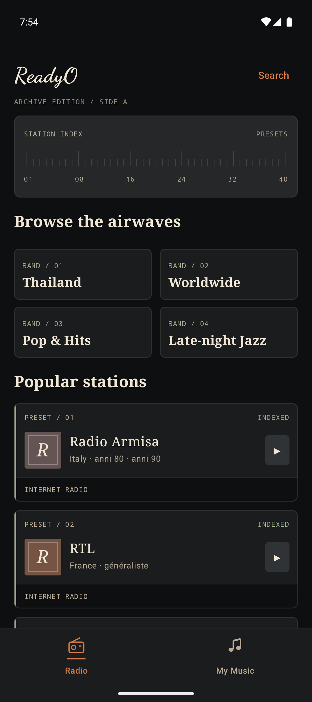
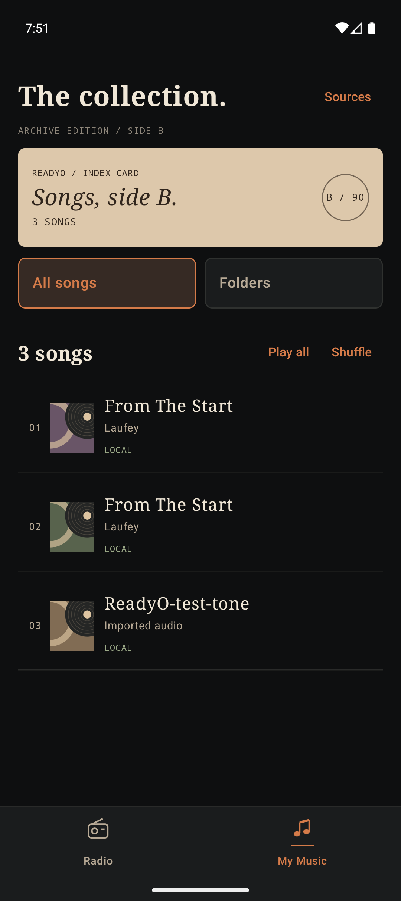
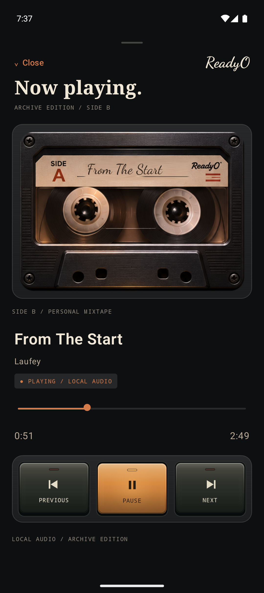

# ReadyO!

A cassette-inspired Android player for internet radio and local music. Browse live stations, link a music folder, or scan your device. Swipe up on the mini player to open the animated cassette deck.

  
  
  

## Run on Android

Open the project in Android Studio with JDK 21 and the Android SDK installed. Select the androidApp configuration and run it on a phone or foldable emulator.

From PowerShell, build and test with:

~~~powershell
.\gradlew.bat :androidApp:assembleDebug :shared:testAndroidHostTest
~~~

The interface is built with Kotlin and Compose Multiplatform. Android playback uses Media3. The iOS entry point shares the interface and still needs a native playback adapter. See [Architecture](ARCHITECTURE.md) for the feature layout and data flow.
